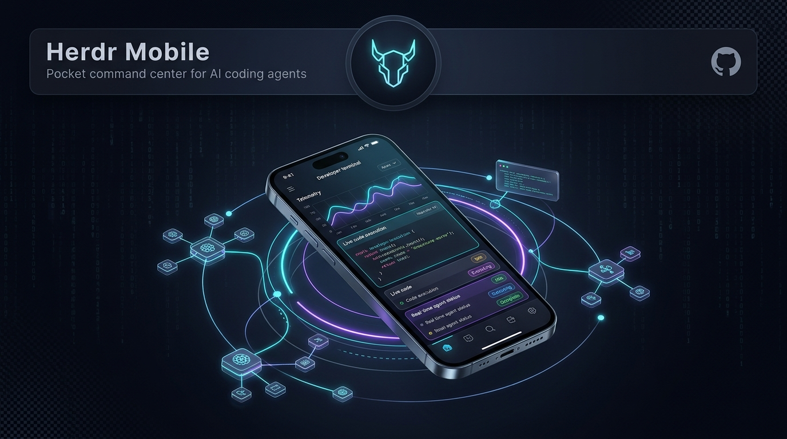
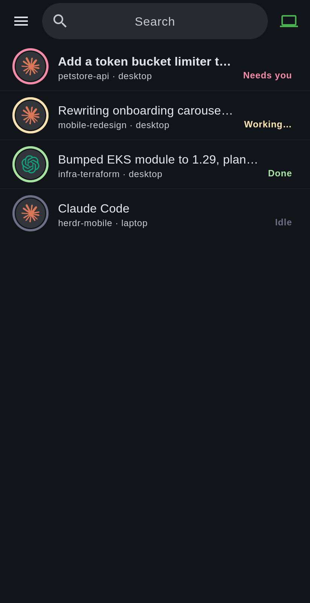
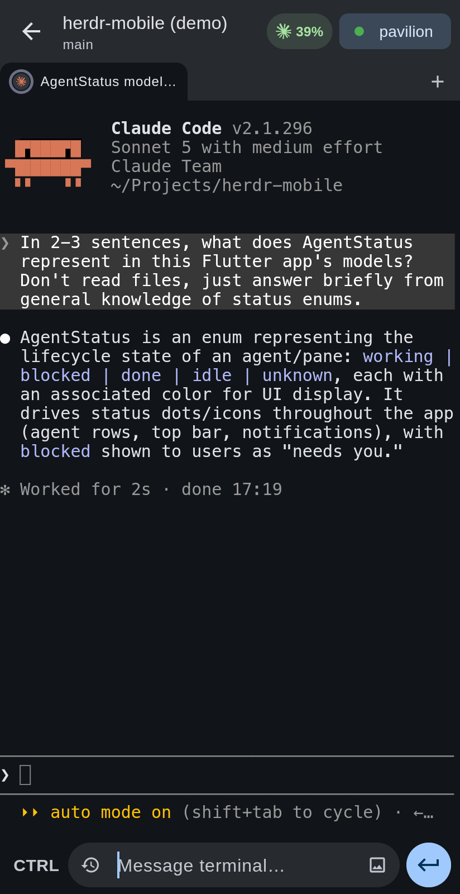
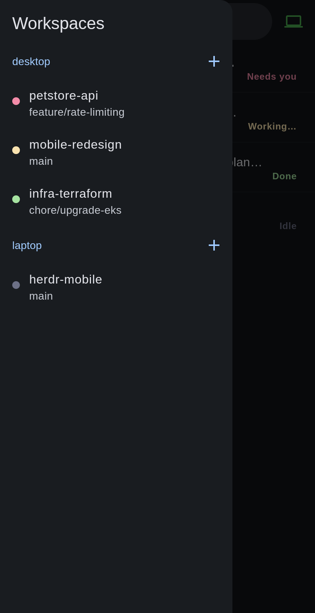
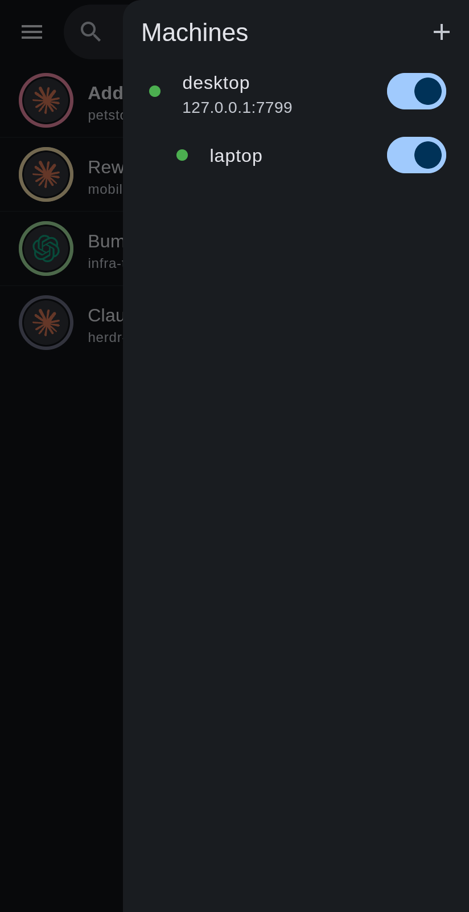

# 🐮 Herdr Mobile

<p align="center">
  
</p>

<p align="center">
  <strong>Pocket command center for your AI coding agents.</strong><br>
  Monitor, prompt, and control your AI agents from anywhere with <a href="https://herdr.dev">Herdr</a>.
</p>

<p align="center">
  <a href="https://github.com/XicuM/herdr-mobile/releases"></a>
  
  
  
</p>

---

<p align="center">
  
  
  
  
</p>

---

## ✨ Features

- 💬 **WhatsApp-Style Agent Feed**: All your AI coding agents across multiple machines aggregated in a single list, prioritized by urgency (`working`, `needs you`, `done`, `idle`).
- ⚡ **Interactive Terminal Streaming**: Low-latency PTY streaming with rendered viewports, touch-friendly scrollback, and bracketed paste message input. The terminal's history comes with it, so scrolling back is instant.
- 🎛️ **Mobile-First Dev Keyboard**: One-tap access to essential terminal keys (`Esc`, `^C`, `Tab`, `⇧Tab`, `Ctrl`, arrow keys) and persistent prompt history / quick replies.
- 🔔 **Instant Background Alerts**: Native Android background notifications ping you the second an agent requires feedback or completes a task.
- 🌐 **Multi-Machine & Multi-Agent**: Every computer you add over SSH, and every machine its herdr-core reaches, in one app.
- 📂 **Spaces & Tabs**: The Herdr app's spaces and tabs, with new, rename, close and drag-and-drop reordering.
- 📱 **Responsive List-Detail UI**: Optimized for single-hand phone use and side-by-side split screen on tablets and foldable devices.

---

## 🏗️ Architecture

```text
┌─────────────────┐            SSH            ┌──────────────────────────┐
│  Herdr Mobile   │ ◄───────────────────────► │ herdr-core (hc connect)  │ ── its own machines (hc machine add)
│  (Flutter)      │   herdr-core's framed     │ + the Herdr desktop app  │
└─────────────────┘   JSON-RPC protocol       └──────────────────────────┘
```

The app speaks [herdr-core](https://github.com/herdrdev/herdr-core)'s own API: it dials each computer over SSH and runs
`herdr-core connect` there, as herdr-core itself dials the machines it adds. Nothing else runs on the computer.

- **Agents** are the terminals whose programs report their status (`hc ls`), live through `events.subscribe`.
- **Spaces and tabs** are the [Herdr app](https://github.com/herdrdev/herdr-app)'s layout (its `herdr-app` document).
  Changing them runs `herdr-app do …` on that computer, so it needs the Herdr window open there.
- **Terminals** stream with `terminal.attach`: the program's real output, its history included.
- **Usage** comes from the `herdr-usage` mod's numbers on the desktop, when it's installed.

The last version for herdr-bridge (Herdr TUI) is on the [`bridge`](https://github.com/XicuM/herdr-mobile/tree/bridge) branch.

---

## 📱 Setup

1. Install the [Herdr app](https://herdr.dev) (or just herdr-core) on each computer.
2. Grab the latest APK from the [**Releases**](https://github.com/XicuM/herdr-mobile/releases) page (a Linux desktop build, `herdr-mobile-linux-{x86_64,aarch64}.tar.gz`, is there too).
3. Open the app, tap the **Machines** icon (top right) ➔ **+**, and give the computer's SSH target, e.g. `me@100.x.y.z` or
   `me@laptop` (Tailscale MagicDNS); add `:port` if SSH isn't on 22.
4. Copy **This phone's key** from that page into the computer's `~/.ssh/authorized_keys`. With
   [Tailscale SSH](https://tailscale.com/kb/1193/tailscale-ssh) on, no key is needed.

Machines that computer's herdr-core reaches (`hc machine ls`) show up under it by themselves.

---

## 🔒 Security & Networking

- **SSH only**: the app opens no port and needs no server of its own; it logs in like any SSH client.
- **Its own key**: an ed25519 key made on the phone, kept in the app's private storage (no Android backups).
- **Host keys** are trusted on first use and checked after; a changed one stops the connection until you forget it on
  the machine's page.
- **Tailscale first**: reach your computers over your Tailnet; port forwarding SSH to the internet isn't needed.

---

## 🤝 Contributing & Development

- `flutter analyze`, `flutter test`, `flutter run`. `test/hc_live_test.dart` talks to this computer's herdr-core when it has one.

---

## License

[GPL-3.0-or-later](LICENSE)
